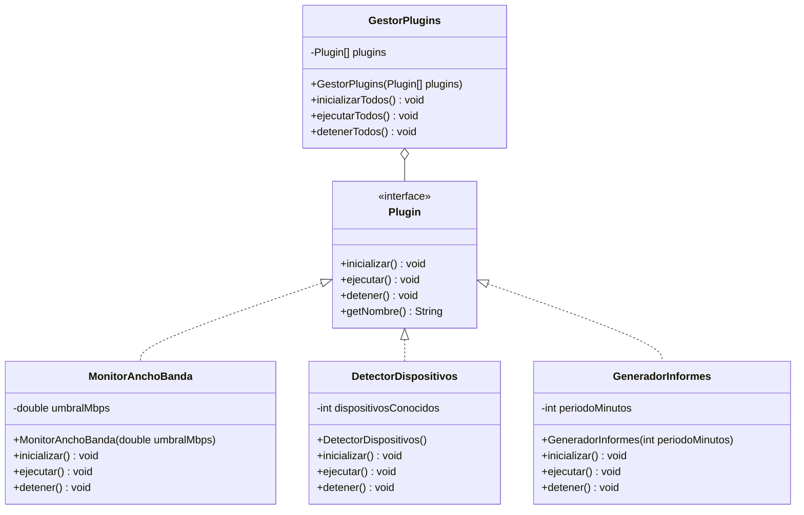

# Ejercicio 10.10 — Diseño libre: sistema de plugins

Antes de implementar las clases, se diseña el diagrama UML del sistema. `Plugin` es una interfaz con tres métodos abstractos y un método `default` que no necesita sobrescritura en las implementaciones habituales. `GestorPlugins` mantiene un array de `Plugin` y coordina su ciclo de vida sin conocer los tipos concretos.

**Notas sobre la notación:**

- `Plugin` lleva el estereotipo `<<interface>>`. Las flechas `<|..`
  representan la relación de **realización** (`implements`) de los tres
  plugins concretos.
- `GestorPlugins` se relaciona con `Plugin` mediante **agregación**
  (`o--`): mantiene una referencia a los plugins, pero no es responsable
  de su ciclo de vida de creación — los plugins se crean fuera de
  `GestorPlugins` y se le pasan ya construidos.
- `getNombre()` no se incluye en las subclases porque ninguna de ellas lo
  sobrescribe: las tres usan la implementación `default` de la interfaz.
