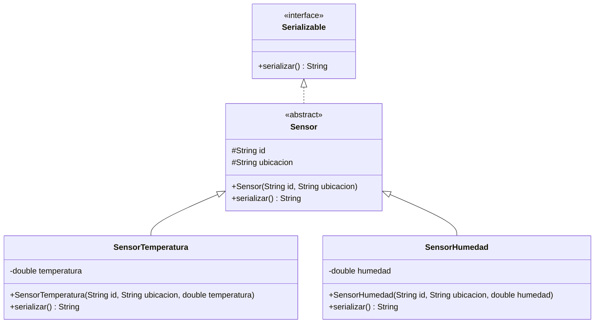

# Ejercicio 10.8 — Diagrama UML

> **Nota sobre el enunciado.** El texto dice literalmente *"Dibuja el
> diagrama de clases UML completo del sistema del ejercicio 10.8,
> el propio ejercicio que estamos resolviendo. Es casi con toda seguridad una errata.
> El propio enunciado describe el sistema a dibujar con precisión —*"la
> interfaz `Serializable` con el estereotipo `«interface»`, la clase
> abstracta `Sensor` con su nombre en cursiva, las subclases concretas..."*—
> y esa descripción coincide exactamente con el sistema `Serializable`/
> `Sensor`/`SensorTemperatura`/`SensorHumedad` del Ejercicio 10.9. Se ha
> resuelto este ejercicio como el diagrama de ese sistema.

**Notas sobre la notación:**

- `Serializable` lleva el estereotipo `<<interface>>`, siguiendo la
  convención UML para interfaces.
- `Sensor` lleva el estereotipo `<<abstract>>` (Mermaid no admite cursiva
  en el nombre de la clase; esta es la misma convención usada en los
  diagramas de capítulos anteriores para representar la cursiva de UML).
  `serializar()` aparece en `Sensor` sin cuerpo (es abstracto en esa
  clase) y con cuerpo concreto en cada subclase.
- La flecha `<|..` (línea discontinua) representa la relación de
  **realización** (`implements`) entre `Sensor` y la interfaz
  `Serializable`; las flechas `<|--` (línea continua) representan
  **herencia** entre `Sensor` y sus dos subclases concretas.
