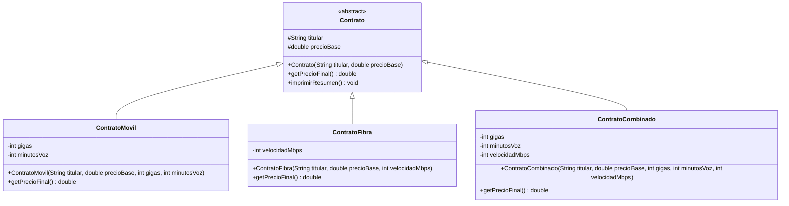

# Ejercicio 9.12 — Diagrama UML de la jerarquía `Contrato`

Diagrama de clases de la jerarquía `Contrato` implementada en el Ejercicio 9.10. La clase abstracta y su método abstracto se muestran en cursiva, siguiendo la convención UML.

**Notas sobre la notación:**

- `Contrato` aparece marcada `<<abstract>>` y su método `getPrecioFinal()` está declarado sin cuerpo en la clase abstracta (en el propio capítulo, la convención UML para miembros abstractos es la cursiva; Mermaid no soporta cursiva en texto de clase, así que aquí se indica con el estereotipo `<<abstract>>`, igual que en los diagramas de capítulos anteriores).
- `imprimirResumen()` es un método concreto (template method) definido solo en `Contrato`; las tres subclases lo heredan sin sobrescribirlo.
- Las flechas `<|--` representan herencia: las tres subclases concretas extienden `Contrato`.
- La visibilidad sigue la convención habitual: `+` público, `-` privado, `#` protegido.
