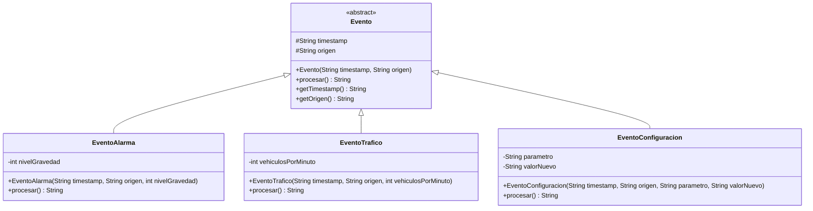

# Ejercicio 9.13 — Diseño libre: sistema de procesamiento de eventos

Antes de implementar las clases, se diseña el diagrama de clases UML del sistema. `Evento` es una clase abstracta sellada (`sealed`), con atributos comunes `timestamp` y `origen`, y un método abstracto `procesar()` que cada tipo concreto implementa de forma distinta. Se definen tres tipos concretos de evento, como pide el enunciado.

**Decisiones de diseño:**

- `Evento` se declara `sealed` con `permits EventoAlarma, EventoTrafico, EventoConfiguracion`. Esto no lo exige el enunciado explícitamente, pero permite que la versión con `switch` y pattern matching sea exhaustiva sin rama `default`, en línea con lo trabajado en los Ejercicios 9.8 y 9.9.
- `procesar()` devuelve un `String` con la descripción del procesamiento (en vez de imprimir directamente), para poder reutilizarlo tanto desde el recorrido polimórfico como desde la versión con `switch`.
- Los atributos concretos de cada evento (`nivelGravedad`, `vehiculosPorMinuto`, `parametro`/`valorNuevo`) son una propuesta razonable para ilustrar el patrón; el enunciado no fija ninguno en particular.
